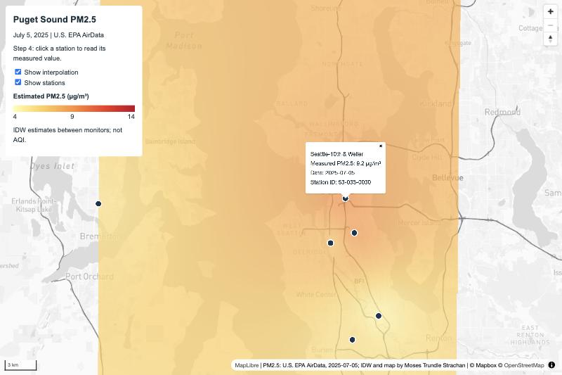
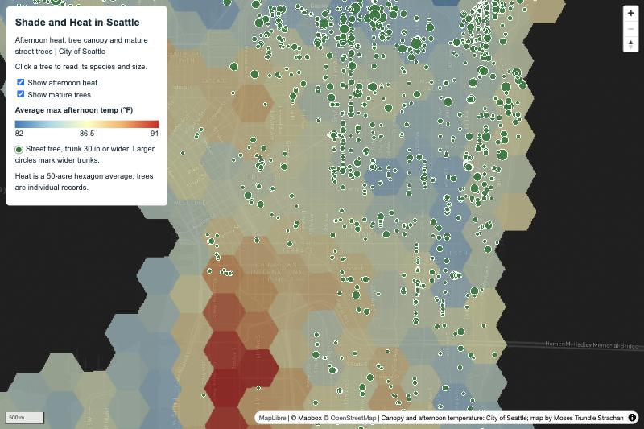

# Lab 3 — Two web maps, four local tile pyramids

Moses Trundle Strachan — GEOG 458

Two interactive maps, each combining a Mapbox-derived basemap, a thematic raster,
and related vector data. All raster content is served as local PNG tile pyramids
rendered ahead of time; the pages request no live map service and need no Mapbox
token. Only the MapLibre GL JS library and stylesheet load from a CDN.

## Map 1 (guided) — Puget Sound PM2.5

`mosestrundlestrachan_lab3-1.html`

**Purpose and audience.** This shows how fine particulate pollution varied across the
central Puget Sound on a certain summer day, for a reader asking whether their part
of the region was better or worse off than the places where pollution is actually
measured.

**Study area.** West/east -122.75 / -122.05, south/north 47.10 / 48.15. Tacoma to
Marysville, including Seattle and Bremerton.

**Sources.** U.S. EPA AirData pre-generated daily summary files
(`daily_88101_2025.zip`), filtered to 2025-07-05, one pollutant, the 24-hour block
average summary, and one eligible instrument per site. Eleven distinct monitoring
sites. Full provenance in `data/pm25_source.json`.

**Processing.** Station points were reprojected from EPSG:4326 to EPSG:32610
(WGS 84 / UTM zone 10N) so that distances are measured in metres. An inverse
distance weighted surface was computed with distance coefficient P = 2 at a 250 m
cell size, over the extent of the projected station layer, producing
`data/pm25_idw.tif` at 135 x 387 cells. Values range 4.100 to 12.099 µg/m³, which
brackets the station range of 4.1 to 12.1 — inverse distance weighting never
produces values outside its inputs.

**Symbology.** Five colour stops, linearly interpolated:

| Value (µg/m³) | Colour |
|---|---|
| 4.0 | `#ffffb2` |
| 6.5 | `#fecc5c` |
| 9.0 | `#fd8d3c` |
| 11.5 | `#f03b20` |
| 14.0 | `#bd0026` |

**Tile exports.** Zoom 8 to 12, 256 x 256 PNG, XYZ naming.
`assets/mapbox-guided/` holds 246 tiles with an opaque background;
`assets/pm25-guided/` holds 237 RGBA tiles with empty areas transparent so the
basemap shows through. The surface is drawn at 70% opacity in the page, which is a
separate control from the transparency baked into the tiles.

**Basemap.** A Mapbox Light style cloned and adapted in Mapbox Studio. Five
commercial point-of-interest classes were excluded — `commercial_services`,
`food_and_drink`, `store_like`, `food_and_drink_stores` and `lodging` — combined
with AND so that a feature must fall outside all five to remain visible. Schools,
hospitals and parks were deliberately kept. Road line colour was made
data-driven on `class`: motorway and motorway_link render as a dark gray `hsl(220, 5%, 45%)`
while all other roads keep the light color. The same expression was applied to `bridge-simple` and `tunnel-simple`,
because those are separate layers and recoloring only the surface roads would
make the freeway flicker light at every bridge and tunnel. `bridge-case-simple`
was checked and left light on purpose: as a casing beneath a dark deck it
separates the bridge from the water rather than competing with it. Road widths,
opacity and all label layers are unchanged.

## Map 2 (independent) — Shade and heat in Seattle

`mosestrundlestrachan_lab3-2.html`

**Purpose and audience.** Shows where Seattle's streets run hottest on a summer
afternoon and how thin the mature tree canopy is on exactly those blocks. This is useful
residents curious whether their neighborhood has less shade than the city average. 
The raster answers this question at the neighborhood scale; the tree points answer it block by block.

**Study area.** West/east -122.37 / -122.26, south/north 47.53 / 47.68. Downtown,
the Central District, Beacon Hill, Columbia City and Rainier Valley.

**Sources.** City of Seattle, both from the Seattle GeoData portal: the
Seattle Tree Canopy 2016–2021 50-acre hexagon layer, and SDOT Trees.

**Processing.** The hexagon layer was clipped to the study area and reprojected to
EPSG:3857, leaving 735 hexagons. The `MEAN` field — average maximum afternoon
temperature in degrees Fahrenheit — was rasterized to a 20 m grid, giving a
613 x 1239 raster with values from 81.9 to 91.0 °F. Tree points were filtered to
`CURRENT_STATUS = 'INSVC'` and a trunk diameter of 30 inches or more, which reduces
125,241 trees in the study area to 3,276 mature ones, a quantity a browser can
draw. Coordinates were rounded to five decimal places and the attributes reduced
to the fields the popup uses.

**Symbology.** A blue-to-red temperature ramp, chosen to be clearly distinct from
map 1's yellow-to-red pollution ramp:

| Value (°F) | Colour |
|---|---|
| 82.0 | `#2c7bb6` |
| 84.25 | `#abd9e9` |
| 86.5 | `#ffffbf` |
| 88.75 | `#fdae61` |
| 91.0 | `#d7191c` |

Trees are drawn as green circles whose radius is interpolated on trunk diameter,
from 3 px at 30 inches to 10 px at 80 inches, and each carries a popup with common
and scientific name, trunk diameter, condition, planting year and street address.

**Tile exports.** Zoom 10 to 14, 256 x 256 PNG, XYZ naming, 96 tiles each. The
higher zoom range suits a study area roughly a tenth the size of map 1's.
`assets/mapbox-independent/` is the basemap; `assets/canopy-heat/` is the thematic
raster with transparent background.

**Basemap.** A classic Mapbox Dark style, adapted by hiding the
point-of-interest label layer so the thematic colours and tree points read
clearly. The classic architecture matters: Mapbox Standard and styles importing it
cannot be served by the Static Tiles API, so a 2D classic style is required for
this workflow.

## Estimates versus measurements

These are not the same kind of number and the maps should not be read as if they
are.

On map 1, the station popups report **measured** values: a 24-hour block average
concentration recorded by an EPA instrument at that location on 2025-07-05. The
colored surface between the stations is an **estimate** produced by inverse
distance weighting from only eleven monitors. It adds no new observations. A
250 m cell size controls how finely the estimate is drawn, not how accurate the
monitoring network is. Clicking a colored pixel cannot recover a measurement,
because the PNG stores appearance rather than values.

Neither the measured values nor the interpolated surface is an AQI figure. AQI is
a separate categorical index derived from concentrations; the numbers here are raw
concentrations in µg/m³.

On map 2, the tree points are individual **records** of specific trees. The heat
raster is a **50-acre hexagon average**, so it describes a neighborhood, not a
address. A hot hexagon does not mean every street within it is hot.

## Known data gaps

- 113 of the 735 hexagons in the map 2 study area carry no temperature value.
  These render transparent rather than being mis-colored at the bottom of the
  ramp.
- The hexagon layer's own documentation does not record the measurement campaign
  or year behind the afternoon temperature field; the units are stated only in the
  layer title.
- Tree `CONDITION` is frequently unrecorded and displays as "Not recorded".
- Map 1's interpolated surface extends across the full study area, including water
  and areas far from any monitor, where it is least trustworthy.

## Method notes

Interpolation and tiling were performed with the GDAL tools distributed with QGIS
(`gdal_grid` for the inverse distance weighting, `gdaldem color-relief` for the
color ramps, `gdal2tiles` for the XYZ pyramids) rather than through the QGIS
graphical interface, using the same parameters the lab specifies. Basemap pyramids
were retrieved directly from the Mapbox Static Tiles API for each published style.

## Screenshots

### Map 1 — Puget Sound PM2.5



The interpolated surface over the Studio basemap, with the eleven monitoring
stations drawn on top and one popup open showing a measured value. The darker
freeway network stays readable through the thematic colours.

### Map 2 — Shade and heat in Seattle



Afternoon temperature by 50-acre hexagon with mature street trees above it. The
relationship the map is built to show is visible directly: a red spine of heat
runs north to south through the industrial flats and the International District
with very few mature trees on it, while the cooler blue hexagons on Capitol Hill
and in the Central District are dense with them.

## Repository structure

```
lab3/
├── mosestrundlestrachan_lab3-1.html
├── mosestrundlestrachan_lab3-2.html
├── README.md
├── data/
│   ├── pm25_puget_sound_2025-07-05.csv
│   ├── pm25_stations.geojson
│   ├── pm25_source.json
│   ├── pm25_idw.tif
│   ├── pm25_utm10.gpkg
│   └── mature_street_trees.geojson
├── images/
│   ├── lab3-1-pm25.jpg
│   └── lab3-2-canopy-heat.jpg
└── assets/
    ├── mapbox-guided/{z}/{x}/{y}.png
    ├── pm25-guided/{z}/{x}/{y}.png
    ├── mapbox-independent/{z}/{x}/{y}.png
    └── canopy-heat/{z}/{x}/{y}.png
```

NOTE*** Claude was used for the formatting and presentation of information within this README. All prose was written by a human.
